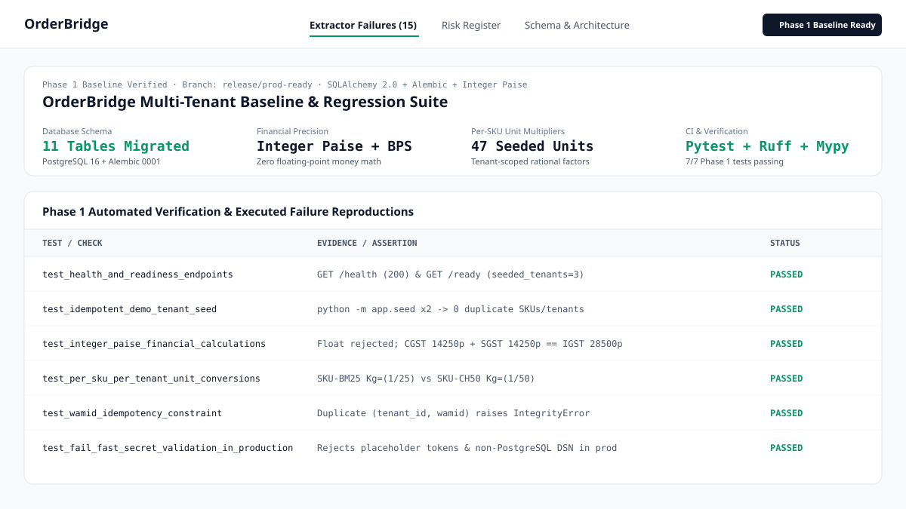

# OrderBridge — Multi-Tenant WhatsApp Order Capture & B2B ERP Sync Suite

**Licence:** Proprietary / All Rights Reserved  
**Target Users:** Indian FMCG Distributors, Kirana Wholesalers, Spices/Horeca Suppliers, and WhatsApp/Instagram D2C Sellers.

OrderBridge captures unstructured WhatsApp orders from Indian buyers in Hinglish, Devanagari, regional languages, shorthand, and voice notes (`"Bhaiya 5 peti Parle-G, dhai katta Basmati 25kg bhej do"`), converts them into structured draft orders using integer-paise financial precision and per-SKU unit conversions, enforces a strict human-in-the-loop review workflow, and exports verified GST orders to **Tally Prime (XML Vouchers)**, **Excel/CSV**, and **Zoho Books**.

---

## Repository Structure

```text
whatsapp-order-processing-system/
├── .env.example                     # Environment variable template (zero committed secrets)
├── .github/workflows/ci.yml         # GitHub Actions CI (Postgres 16, ruff, mypy, alembic, seed, pytest, vite)
├── .pre-commit-config.yaml          # Pre-commit hooks (ruff lint/format, secret detection)
├── AUDIT.md                         # Phase 0 read-only audit & executed failure evidence
├── README.md                        # Project overview, setup, and architecture
├── docker-compose.yml               # Local stack: PostgreSQL 16 + FastAPI container
├── config/
│   └── tenants.json                 # Canonical seed catalogue (integer paise, per-SKU units, HSN, customers)
├── docs/
│   ├── PHASE1_PLAN.md               # Phase 1 implementation plan & acceptance criteria
│   ├── adr/
│   │   └── 0001-postgresql-sqlalchemy-alembic.md
│   └── screenshots/
│       └── phase1_baseline.svg      # Verified Phase 1 Baseline & Audit console snapshot
├── backend/
│   ├── Dockerfile                   # Multi-stage slim Python 3.11 non-root container ($PORT aware)
│   ├── alembic.ini                  # Alembic migration configuration
│   ├── pyproject.toml               # Ruff, Mypy, and Pytest configuration
│   ├── requirements.txt             # Pinned Python runtime and QA dependencies
│   ├── alembic/
│   │   ├── env.py
│   │   └── versions/
│   │       └── 0001_initial_schema.py
│   ├── app/
│   │   ├── __init__.py
│   │   ├── config.py                # Env settings, fail-fast secret checks & GCP Secret Manager loader
│   │   ├── db.py                    # SQLAlchemy 2.0 engine & transactional session factory
│   │   ├── models.py                # Multi-tenant schema (SkuUnit, InboundMessage wamid, AuditLog, JobQueue)
│   │   ├── money.py                 # Exact integer-paise & basis-points GST financial engine
│   │   ├── seed.py                  # Idempotent demo-tenant seeder (`python -m app.seed`)
│   │   ├── main.py                  # FastAPI server (/health, /ready, webhooks, tenants, extraction, ERP export)
│   │   ├── extractor.py             # Order extraction engine
│   │   ├── failover.py              # Business continuity & channel health controller
│   │   └── accounting_sync.py       # Tally Prime XML, Excel/CSV, Zoho Books, Xero adapters
│   └── tests/
│       └── test_phase1_baseline.py  # Automated baseline, integer-paise, wamid & fail-fast tests
├── src/                             # React 19 + TypeScript + Tailwind v4 Workbench
└── frontend/
    └── index.html                   # Standalone interactive demo file
```

---

## Quick Start (Clean Clone)

### Option 1: Docker Compose (PostgreSQL 16 + FastAPI)
```bash
cp .env.example .env
# Set a local development password in .env (e.g. POSTGRES_PASSWORD=local_dev_pw_2026)
docker compose up --build -d
curl http://localhost:8000/health
curl http://localhost:8000/ready
```

### Option 2: Local Python 3.10+ & Node 22+
```bash
cd backend
pip install -r requirements.txt
alembic upgrade head
python -m app.seed
pytest -v
uvicorn app.main:app --reload --port 8000
```

---

## Latest Application State (Phase 1 Baseline Verified)


