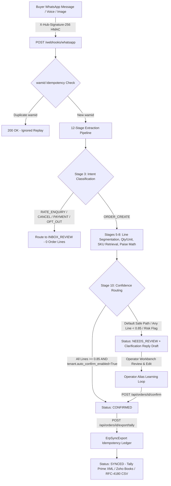
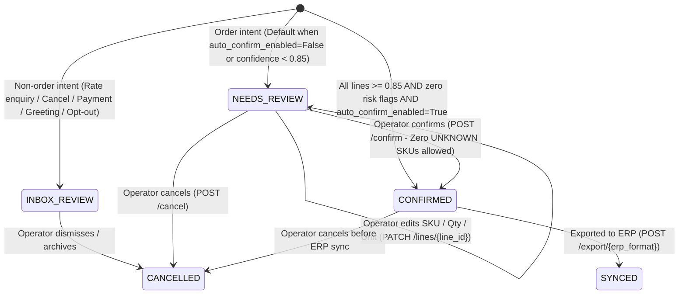

# OrderBridge System Architecture

OrderBridge is a multi-tenant B2B commerce capture platform engineered for Indian distributors, wholesalers, C&F agents, and D2C brands. Buyers place orders over WhatsApp without installing apps or creating accounts; OrderBridge converts unstructured Hinglish, Devanagari, regional-script, voice, and image messages into verified, GST-compliant draft orders and exports confirmed vouchers to Tally Prime, Zoho Books, and Excel/CSV.

---

## 1. End-to-End Message & Order Flow

---

## 2. Order Lifecycle State Machine

---

## 3. Multi-Tenant Isolation Model

Every database table (`tenants`, `users`, `tenant_memberships`, `skus`, `sku_units`, `learned_aliases`, `customers`, `inbound_messages`, `draft_orders`, `draft_order_lines`, `order_audit_logs`, `erp_sync_exports`, `raw_webhook_events`) enforces strict tenant isolation:

1. **JWT-Scoped Tenant Context:** Authenticated API endpoints resolve `tenant_uuid` and `role` (`OWNER | STAFF | VIEWER`) exclusively from the HMAC-SHA256 signed JWT bearer token (`backend/app/auth.py`). Path or query parameters cannot override the caller's tenant scope.
2. **Scoped SKU & Alias Catalogues:** `LearnedAlias` and `Sku` rows carry composite uniqueness constraints scoped to `tenant_id` (`uq_alias_tenant_phrase`, `uq_sku_tenant_code`). An operator alias learned in `patel_fmcg` never affects extraction in `glow_insta` or `metro_fresh`.
3. **Scoped Webhook Idempotency:** Inbound WhatsApp messages enforce `UniqueConstraint("tenant_id", "wamid", name="uq_tenant_inbound_wamid")` so Meta webhook retries are deduplicated per tenant without cross-tenant collision.
